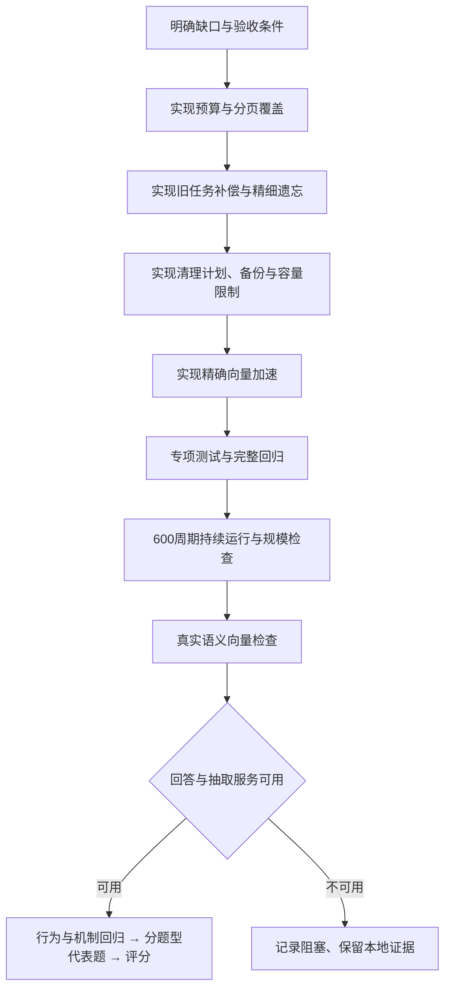

# 记忆系统缺口补齐流程

范围：沿用当前记忆系统，补齐已分析的六项工程缺口。保留既有未提交改动和旧实验结果；真实回答效果单独验收。

| 顺序 | 工作与产物 | 验收条件 |
|---|---|---|
| 1 | 可配置的预算计数器：保守 UTF-8 字节上界、本地 tokenizer、旧估算消融；写入、索引、召回和回答接入 | 中文、表情、代码及长文本不超所选计数器预算；记录计数方式和 tokenizer 指纹；配置错误不静默退回估算 |
| 2 | 聚合候选全量扫描、分页处理与覆盖记录 | 超过 top-k / 单页预算的贡献仍被处理；扫描或分页上限、格式错误、遗漏时不输出完整合计；引用、单位、重复和算术核验继续生效 |
| 3 | 旧数据补偿和索引升级入口 | 按指定会话或失败日志预览补偿范围；显式排队、可重试、幂等；不把“无事实”自动判断为抽取失败；遗忘数据不复活 |
| 4 | 有确定来源区间的细粒度遗忘 | 核验唯一引文与字段值后生成安全视图，保留同轮其他内容；旧向量与关键词不能泄漏；区间不明确或验证失败时继续保守屏蔽；重启、补抽及 reindex 均一致 |
| 5 | 存储清理预览、备份、保留策略与执行入口 | 默认只预览；删除范围可复核；执行前备份；版本链、来源、FTS 和向量无悬挂；临时库实际清理后通过完整性检查；既有用户库不自动清理 |
| 6 | 精确向量打分加速与持续运行验收 | 加速与基准排序一致；没有可选依赖仍可运行；持续写入、更新、归档、遗忘、重启和清理通过；规模结果记录来源、环境、时间和限制 |

执行时先跑各模块针对性回归，再跑统一验收。临时测试库可以实际删除数据；现有记忆库仅生成维护预览。本轮不把工程检查通过等同于真实模型准确率通过。

## 执行路径



本轮代码已接入六条路径；统一验收使用相同源码版本，保存源码、提示词、测试脚本及输入指纹。测试数据均为独立临时库或自拟案例；参考答案只进入评测器。

```bash
# 安装可选本地 tokenizer 与矩阵打分依赖；可使用已有独立虚拟环境
python3 -m venv .venv
.venv/bin/python -m pip install -e '.[strict,fast]'

# 本地工程验收；基础 Python 同时验证没有可选依赖时的运行路径
PYTHONPATH=src python3 scripts/validate_memory_system.py --config config.json \
  --system-gaps --extended-python .venv/bin/python --out runs/system-gaps-local

# 真实服务可用时执行完整验收；前置失败会保留日志并跳过依赖阶段
PYTHONPATH=src python3 scripts/validate_memory_system.py --config config.json \
  --system-gaps --extended-python .venv/bin/python --full --out runs/system-gaps-full
```

## 维护入口

旧版未排队失败不能仅凭“没有事实”判断。`repair` 接受明确会话或提取失败日志（JSON / JSONL，包含 `session_id` 及 `extract_failures` 或 `retry_rounds`）。预览中的 `unproven_empty_sessions` 只供人工核查。排队后执行 `rebuild`，成功任务标记 completed；同一来源重试不重复强化事实。已遗忘、被屏蔽或生成安全视图的原文不会补抽。

```bash
memsys repair --db '<原库目录>/<用户>.sqlite' --session s12 --out repair-preview.json
memsys repair --db '<原库目录>/<用户>.sqlite' --session s12 --apply
memsys rebuild --config config.json --user '<用户>' --data-dir '<原库目录>'
memsys reindex --config config.json --user '<用户>' --data-dir '<原库目录>'
```

`cleanup` 默认预览遗忘载荷的清理范围，指定 `--archive-before YYYY-MM-DD` 可增加过期归档。应用已保存计划前验证内容指纹和数据库版本，先备份再删除、重建 FTS、检查引用并压缩。有效事实需要的来源保留为安全视图或屏蔽墓碑；版本链 ID 保留为空载荷墓碑。受影响的已整理原始对话前缀也会被清空，选择性安全视图会写回。备份保留原数据，备份本身的保留期限由调用方管理。

```bash
memsys cleanup --db '<原库目录>/<用户>.sqlite' --out cleanup-preview.json
memsys cleanup --db '<原库目录>/<用户>.sqlite' --plan cleanup-preview.json \
  --backup '<新备份路径>.sqlite' --apply
```

## 能力与边界

- **预算**：默认 `budget_mode=utf8` 以 UTF-8 字节数保守限制内容；`tokenizer` 使用本地 `budget_tokenizer_path`，记录文件 SHA256，配置或依赖错误直接报错；`estimate` 保留旧估算用于消融。抽取、裁决、查询分析、重排、工作记忆和回答使用同一计数口径。完整聊天输入额外预留每条消息8单位；这不是服务端聊天模板的精确 token 数，实际用量仍取 API `usage`。本地分词器须与所用模型匹配。[Tokenizers 文档](https://huggingface.co/docs/tokenizers/v0.20.3/api/tokenizer)、[DeepSeek 用量说明](https://api-docs.deepseek.com/quick_start/token_usage/)。
- **分页聚合**：需要全部候选时扫描当前与归档层，取消普通 top-k 截断；超过5000条可搜索候选、128页或5000条贡献时拒绝合计，这些限制可配置。每页检查 `reviewed` 是否涵盖全部供给来源，再验证引文、数值、单位、显式重复和合并结果。数值分页支持同单位求和、明确名称或物品去重计数，以及明确群体数量；其他数值操作拒绝完整合计。非数值列表和对比另用分页精确引文与有界综合。扫描完整指“配置相关性条件下检索候选完整”，不能证明语义相关性、别名和事件身份判断正确。外部 agent 可用 `recall_pages()` 取得页面及覆盖标记；单块 `recall()` 不足时给出覆盖警告。
- **细粒度遗忘**：抽取输出可包含 `source_quotes`；只有每个来源中唯一引文、字段值可字面核验，且不会破坏其他有效事实时，才能生成遮盖该字段值的安全视图。整轮旧向量删除，FTS 切换安全文本，近期会话同时遮盖；`reindex` 可重建安全向量。旧库、重复引文、别名或语义推断无法通过证据条件时，继续屏蔽整轮。软遗忘保留原始审计载荷，物理清理另走上述入口。
- **容量**：活跃条目默认5000事实、2000轮；数据库分配页默认256 MiB，超过上限且继续增长的事务回滚，允许读取或清理已有超限库。`max_storage_bytes=null` 可关闭；WAL、备份和其他文件单独计量，不在分配页限制内。归档不会自动缩小物理文件，清理须由保留策略明确选择。
- **加速与持续运行**：`fast` 可选依赖使用 NumPy 精确矩阵打分，`MEMSYS_VECTOR_BACKEND=python` 可强制基准路径。没有 NumPy 时用 Python；仍为线性扫描，无 ANN 索引。600周期验收包含合成日期推进、容量归档、更新、遗忘、旧任务补偿、重启、索引重建及实际清理，不等同于生产环境连续运行600天。

## 执行记录

本轮完整统一验收目录：`runs/system-gaps-v2`。`v1` 保留最初失败证据：严格预算下验证替身批次数不足，以及扩展运行时符号链接解析使 tokenizer 检查跳过。后续真实向量检查进一步发现来源扩展重复加分挤占尾部证据，已修复并新增固定向量回归；原600单位预算保持不变。实际结果以该目录 `workflow.json`、`report.md` 及各阶段报告为准。


| 验收项 | 实际结果 |
|---|---|
| 完整回归 | 基础 Python 3.9.6：241项、0失败、2项可选依赖跳过；扩展 Python 3.12.14：241项全部通过、无跳过 |
| 新增专项 | 20项覆盖严格预算、分页失败拒绝合计、来源扩展排序、精细遗忘与回退、旧任务补偿、清理备份及篡改计划拒绝、容量回滚、加速一致性 |
| 输入覆盖 | 500题、5483轮；抽取与分段向量输入无丢失、无预算超限；本项使用空输出替身，不验证抽取准确率 |
| 生命周期 | 100、1000、10000量级的容量归档、历史回查、重复维护与预算检查全部通过 |
| 持续运行 | 600个合成周期、12次重启、12次重建索引、6次旧任务补偿、10次遗忘、3次实际清理，全部检查通过 |
| 真实向量 | BGE-M3 1024维；跨语言事实2/2、用户与助手长原文尾部2/2通过；旧前缀模式尾部0/2 |
| 精确加速 | 100/1000/10000条1024维向量，排序一致；最大绝对误差约1.1×10⁻¹⁴；NumPy 2.3.5，Tokenizers 0.22.2 |
| 检索规模 | 10000条合成记忆、5次查询：基础 Python 后端P50 596.7ms/P95 601.7ms；扩展 NumPy 后端P50 16.4ms/P95 56.8ms。两者解释器版本不同，不把全部差异归因于矩阵打分；不含模型调用 |
| 真实模型与全量效果 | DeepSeek chat/memory均返回 HTTP 402 Insufficient Balance；行为、机制、Oracle 500题回答、评分及最终效果报告按依赖跳过 |

上述工程验收的源码 SHA256：`d2fff843e9740259273c25aca45cc3db5a28cd2d0f26fa2035cd53bfadaa0821`。生命周期、持续运行、真实向量及加速报告均核对为相同来源；源码、验证脚本或输入改变后使用新目录。

上述历史流程总体状态为 **blocked**，10个系统工程与向量阶段通过。当时未执行真实行为、机制和500题效果验收；该记录不能用于当前模型接入后的效果判断。细粒度遗忘、分页支持范围、聊天模板余量和存储限制的适用边界见上文。

预算报告为兼容旧版本保留 `*_tokens` 字段和部分日志标签；本轮实际单位是 `budget_counter.unit=utf8_bytes`。Tokenizers模式已通过本地依赖、文件内容变更指纹及计数回归，尚未用匹配DeepSeek的模型分词器核对服务端聊天用量。

## 模型接入后的继续构建

使用现有 OpenCode Go 配置，回答、记忆和本地评分的首选模型为 GPT-6 Luna，保留既有额度切换候选池；语义向量继续使用本机 BGE-M3。账本记录每次实际使用的模型，未配置价格的调用仍记为费用未知。

| 验收顺序 | 工作 | 状态与证据 |
|---|---|---|
| 1 | 真实调用验证及完整工程检查 | `runs/system-gaps-api-v1`：接口可用，260项回归通过；真实回答6/10、机制10/12，不把可调用等同于效果合格 |
| 2 | 数量证据、输出格式与分页来源重复修复 | 支持明确群体数量的英文数词与数字证据；单件物品按字面名称计数；只输出数字时单位留在计算证据中；分页事实与原文重叠时只让原文贡献 |
| 3 | 真实回归复查 | `runs/system-gaps-api-v2`：264项回归通过；真实回答9/10；机制10/12，包含1项服务错误；分页语义检查未通过，保留原始失败结果 |
| 4 | Responses消息阶段处理 | 原始响应含 `commentary` 与 `final_answer`，拼接后导致重复答案及无效JSON。适配器改为取最终答案，历史助手消息保留阶段；新增格式、拒绝和缺失最终答案回归 |
| 5 | 相同源码下重新验收 | `runs/system-gaps-api-v3`：269项回归通过，真实回答10/10、机制11/12（其余为服务端400错误）；分页付款去重通过，群体数量选错操作及跨页单位不一致失败 |
| 6 | 跨页模式约束与证据修正 | 明确区分三种计算模式，后续页面固定已经验证的操作与单位；证据失败只允许一次完整重读修正，仍错误就拒绝合计；每次输入计数与错误入trace |
| 7 | 修正后完整验收 | `runs/paged-api-v4` 与统一流程 `runs/system-gaps-api-v4` 的三项分页检查全部通过，预算仍为600；272项回归全部通过。统一流程发现一次输出截断和一次非数值列表误入计算通道，保留失败记录 |
| 8 | 回答完成状态与非数值分页 | 未完成、空白或只有NOTES的输出允许一次预算内重试；仍未完成时报错，不保存部分答案。列表与对比使用逐页精确引文选择及预算内综合，不再要求数值操作 |
| 9 | 增加真实列表分页检查并重跑 | `runs/system-gaps-api-v5` 验证277项回归、10项回答、12项机制及四项分页语义检查，再按依赖进入Oracle与评分 |
| 10 | 可选检索模型的服务降级 | `v5` 的277项、回答10/10和分页4/4通过；机制11/12，剩余为查询规划HTTP 400。查询规划或重排的非账户服务错误退回本地检索，并记录 `service_fallback` / `retrieval_errors`；账户错误仍上抛，最终生成错误仍上抛或拒绝完整结论 |
| 11 | 测试与基准隔离 | `runs/system-gaps-api-v6` 泄漏检查发现新增通用单测问句与真实题目偶然重合；换成独立的陨石样品例子，保留失败记录，系统源码未因此改变 |
| 12 | 全部门槛通过 | `runs/system-gaps-api-v7`：281项回归、回答10/10、机制12/12、分页4/4通过；Oracle启动后，独立评分接口预检发现最低输出预算16而旧评分器请求10，主动终止本轮以修复，保留全部证据 |
| 13 | 评分完整性 | 评分预算改为256，未完成或非yes/no响应只修正一次（512预算），仍无有效标签就保持未评分并报告错误；保存实际评分模型和每次返回状态。真实正反两例正确给出yes/no |
| 14 | 当前完整验收 | `runs/system-gaps-api-v8`：284项回归及全部真实门槛，之后执行Oracle和本地评分；仅复制v7中12个已完成且写入指纹一致的记忆库，不复制答案或分数，原写入费用保留在v7账本 |
| 15 | 日期间隔的来源与当前日期核验 | `v8` 的284项、机制12/12、分页4/4通过；回答9/10，日期案例把会话日期当成今天。新增 `date_difference` 凭据：精确引用日期、可信TODAY、程序计算完整日/周/月/年；缺失凭据或模糊日期不能给出精确数字。专项6项通过，真实回答复查10/10 |
| 16 | 当前完整验收 | 日期凭据加入后更新原有行为和聊天生命周期的替身响应，使其提交真实引用的日期凭据；`runs/system-gaps-api-v10` 验证290项回归及全部真实门槛，再进入Oracle与评分。写入缓存来源和费用边界由 `oracle/cache_origin.json` 记录 |
| 17 | 全量回放暴露日期路由缺陷 | v10保留59份答案后停止；部分“多少天之前”“经过多少天”的问法误入数量合计。扩大通用日期间隔识别，加入请求单位核验，以及实际供给来源日期的引用能力，不复制旧答案 |
| 18 | 真实日期来源验收 | v11新增三个独立日期案例全部失败，发现模型没有把来源标题与原文一起引用，或误认为TODAY需要记忆引文。保留失败结果并停止全量依赖；明确两种端点格式、标题与事件语句的连续引用，以及仅数字要求只适用于ANSWER |
| 19 | 修正后验收与回放 | `runs/date-api-v12-probe`三个真实日期案例全部通过；v12的294项回归、回答10/10、机制12/12、日期3/3通过。分页检查保留两次未通过记录，第三次相同源码的完整复查4/4通过。Oracle保留120份答案后，按用户要求终止500题回放，未据此计算准确率；历史费用及缓存来源仍保留 |
| 20 | 服务拒绝与未完成状态分离 | 原始响应的 `incomplete_details.reason=content_filter` 被旧适配器误报为输出长度不足。现在明确区分过滤、拒绝、长度与其他未完成状态；过滤或拒绝不重写提示词、不换模型、不拆分重提。抽取保留待补队列，部分JSON及部分答案不进入正式结果，评分也不接收部分标签 |
| 21 | 代表题工程验收 | `runs/representative-api-v13/engineering-v2`：基础299项（2项可选依赖跳过），扩展299项全部通过；10项工程与向量阶段通过，包含600合成周期。最初失败的测试替身修正记录保留在 `engineering/` |
| 22 | 代表题真实评测 | `runs/representative-api-v13`固定34题：六种题型各5道有答案题，再加入四种可用题型各1道拒答题。全部重新抽取、建库、作答与评分；不复用v12答案或记忆库。正确18/34（52.9%），拒答3/4；基线显示累计状态、对象归属、事件范围和日期语义仍不可靠 |
| 23 | 代表题驱动的修复 | 缩窄活动耗时与日期相减的路由；明确序号优先保留原文编号条目；纠错省去重复旧稿。`runs/representative-fixes-v14`的303项回归及工程阶段通过，12道定向题正确7/12；耗时与序号题恢复正确，日期纠错仍因原提示接近输入上限而阻塞 |
| 24 | 有界纠错与最终定向复测 | 原提示接近上限时，以全部实际供给证据、原问题、调用方时钟、错误与相同计算规则构造较短纠错请求，仍超限则拒绝。`runs/representative-fixes-v15`基础304项（2项可选依赖跳过）、扩展304项及10个工程阶段通过，真实固定日期3/3通过；最新5道定向题正确2/5，另2题证据校验失败、1题服务阻塞。纠错能在原预算内发出，但日期语义效果尚未通过 |

v10的290项回归、机制12/12和分页4/4通过。首轮回答有9项正确及1项服务端400错误，没有答错；在模型、源码、提示词、测试与数据指纹均不变的情况下，完整重跑10项回答全部通过。首轮保留在 `behavior/`，重试保留在 `behavior-retry-1/`，原始流程保留在 `initial-workflow.json`。随后全量回放发现日期路由缺陷，保留59份答案及原库后停止，未评分；这批答案不能充当当前版本的准确率。34题基线使用v13来源指纹 `c3759c371e6703c2dab1ae34bea2cec112a0d6f779ed61a076f4933d5d2bda10`；当前v15工程及定向复测使用 `eb59adeebd83e0bdd33053a40eeedd69b0dfc5dec2b43bed3382e4cad3f9d935`。完整诊断、修复与尚未完成的语义工作见 [代表题评测与修复报告](../runs/representative-fixes-v15/assessment.md)，不合并不同版本分数。

### 代表题范围与复现

按历史UTF-8长度排序，在每种题型选择0%、25%、50%、75%、100%位置的有答案题；拒答题取各可用题型的历史长度中位题，长度相同时用固定种子哈希打破平局。选择只使用题型、题号、拒答标记与历史长度，不查看参考答案内容、旧答案或分数。`selection.json`保存全部题号、选择方法及原始数据和样本指纹。这个诊断样本包含长度两端，不能外推500题准确率。

```bash
python3 scripts/select_representative.py --data data/longmemeval_oracle.json \
  --out runs/representative-new
PYTHONPATH=src python3 -m memsys bench run --config config.json \
  --data runs/representative-new/sample.json --out runs/representative-new/oracle --workers 16
PYTHONPATH=src python3 -m memsys bench judge --config config.json \
  --data runs/representative-new/sample.json \
  --hyp runs/representative-new/oracle/hypotheses.jsonl --workers 16
PYTHONPATH=src python3 -m memsys bench report \
  --data runs/representative-new/sample.json --run runs/representative-new/oracle
```

拒绝与未完成原因的区分依据[Responses官方字段说明](https://developers.openai.com/api/reference/resources/responses/methods/retrieve)。历史待补队列原库保留；在独立副本上的恢复仍被服务过滤阻塞，不能把它算作恢复成功。

Responses的消息阶段含义与回放要求依据[OpenAI官方说明](https://developers.openai.com/api/docs/guides/reasoning#phase-parameter)。保留未带阶段字段的兼容服务；只有中间消息的已完成响应不会被当作最终答案。完整API用量仍按整次响应记录。

新增自拟分页语义检查使用固定记忆与真实回答模型，分别验证事实与原文重复、英文群体数量、已拥有物品与助手建议的区分，以及长原文中的推荐范围和列表顺序。它不经过模型抽取，不代表Oracle准确率。参考答案只进入检查器。源代码、提示词或输入变动后启动新目录，失败记录不覆盖。

非数值分页保留每页的完整审阅标记，只接受当前页中的精确原文引文；摘要、虚构引文或未提供的来源不能进入最终回答。全部已核验引文必须同时满足配置的记忆内容预算与完整回答输入预算，超过预算就拒绝完整回答，不静默丢弃后面的证据。引文真实性和页面覆盖检查不能证明模型正确判断了相关性、推荐范围或回答顺序。

日期间隔只接受ISO、英文或中文的完整日级日期，月份或年份不能补造具体日期。相对现在的`ago/since`结束端及`until`开始端使用调用方TODAY；明确比较两个历史事件时使用各自来源日期。程序核对请求单位、计算完整单位，月末和闰年使用现有日历月推进规则。实际供给模型的来源标题可与事件原文一起引用，但记录日期不自动等于事件发生日期，事件日期关系仍由模型判断。本能力验证日期、精度和算术，不证明模型正确选取了活动、付款或预订的日期。分页日期综合同样必须通过日期凭据校验。
